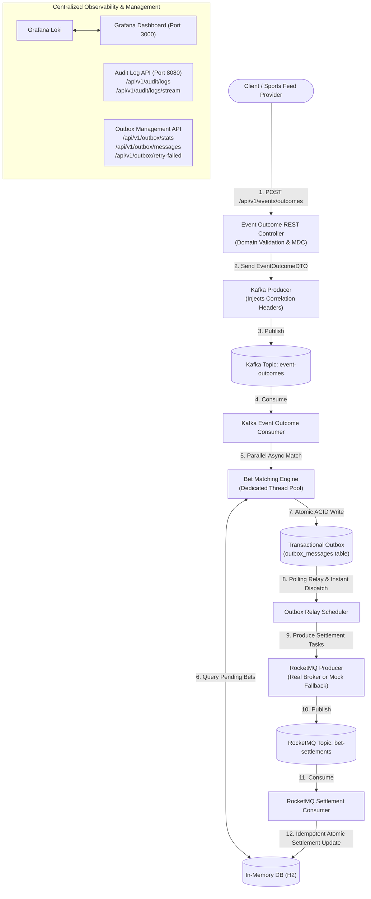

# Sports Betting Settlement Trigger Service

A production-grade, event-driven backend service built in **Java 21** with **Spring Boot 3**, simulating sports betting event outcome handling and bet settlement via **Apache Kafka** and **Apache RocketMQ**, with an **in-memory database** and **centralized observability & logging**.

---

## 1. Architecture & End-to-End Pipeline



### Flow Breakdown:
1. **API Endpoint (`POST /api/v1/events/outcomes`)**: Validates client authentication & allowed domain whitelist, assigns a distributed `traceId`, and publishes event outcome to Kafka.
2. **Kafka Producer**: Serializes and sends the event outcome to the `event-outcomes` Kafka topic, injecting trace and correlation headers.
3. **Kafka Consumer**: Listens to `event-outcomes`, restores the trace context in `MDC`, and submits matching to a dedicated async thread pool to allow subsequent events to process in parallel.
4. **Bet Matching Engine**: Queries pending bets matching `eventId`, calculates odds and payouts (`WON`/`LOST`).
5. **Transactional Outbox**: Rather than making unsafe external network calls directly within business logic, the matching engine writes each settlement event into the `outbox_messages` table within the **same local ACID database transaction**.
6. **Outbox Relay Scheduler**: Continuously polls pending outbox records (with an immediate zero-latency async dispatch trigger) and publishes them to RocketMQ.
   - Upon broker acknowledgment: marks outbox record as `PUBLISHED`.
   - On connection failure: retries with exponential backoff up to `maxRetries`. Exceeded retries move the event to `FAILED` (outbox dead-letter queue) and can be replayed via `POST /api/v1/outbox/retry-failed`.
7. **RocketMQ Consumer**: Consumes settlement messages, executes atomic conditional update in DB (`UPDATE bets SET ... WHERE bet_id = ? AND status = 'PENDING'`), ensuring end-to-end idempotency.

---

## 2. Zero Hardcoding Policy

**Zero tokens, passwords, URLs, or topic names are hardcoded in the code.** Everything is dynamically injected through Spring Boot's `@ConfigurationProperties` and externalized environment variables with sensible defaults:

| Property | Environment Variable | Default Value | Description |
| :--- | :--- | :--- | :--- |
| `server.port` | `SERVER_PORT` | `8080` | Application HTTP port |
| `app.security.auth-token` | `APP_SECURITY_TOKEN` | *(empty = auth disabled)* | API security token (enforces `X-Auth-Token`) |
| `app.kafka.embedded.enabled` | `KAFKA_EMBEDDED` | `true` (`false` in `docker` profile) | `true` = start an in-process Kafka broker (standalone); `false` = use `KAFKA_BOOTSTRAP_SERVERS` |
| `spring.kafka.bootstrap-servers` | `KAFKA_BOOTSTRAP_SERVERS` | `localhost:9092` | External Kafka broker address (used when `KAFKA_EMBEDDED=false`) |
| `app.kafka.topics.event-outcomes` | `KAFKA_TOPIC_EVENT_OUTCOMES` | `event-outcomes` | Topic for event outcomes |
| `spring.kafka.consumer.group-id` | `KAFKA_CONSUMER_GROUP` | `sporty-settlement-group` | Kafka consumer group ID |
| `app.rocketmq.enabled` | `ROCKETMQ_ENABLED` | `false` | `false` = Standalone Mock mode; `true` = Real RocketMQ |
| `app.rocketmq.name-server` | `ROCKETMQ_NAME_SERVER` | `localhost:9876` | RocketMQ NameServer address |
| `app.rocketmq.topics.bet-settlements` | `ROCKETMQ_TOPIC_BET_SETTLEMENTS`| `bet-settlements` | Topic for bet settlements |
| `app.rocketmq.producer-group` | `ROCKETMQ_PRODUCER_GROUP` | `sporty-bet-settlement-producer-group` | RocketMQ producer group |
| `app.rocketmq.consumer-group` | `ROCKETMQ_CONSUMER_GROUP` | `sporty-bet-settlement-consumer-group` | RocketMQ consumer group |
| `app.matching.thread-pool.core-size` | `MATCHING_POOL_CORE_SIZE` | `10` | Core threads for parallel async bet matching |
| `app.matching.thread-pool.max-size` | `MATCHING_POOL_MAX_SIZE` | `50` | Maximum threads for parallel async bet matching |
| `app.outbox.enabled` | `OUTBOX_ENABLED` | `true` | Enable Transactional Outbox Pattern for guaranteed dispatch |
| `app.outbox.poll-interval-ms` | `OUTBOX_POLL_INTERVAL_MS` | `500` | Polling delay (ms) for outbox relay scheduler |
| `app.outbox.batch-size` | `OUTBOX_BATCH_SIZE` | `50` | Number of outbox messages processed per relay cycle |
| `app.outbox.max-retries` | `OUTBOX_MAX_RETRIES` | `5` | Maximum retry attempts before marking outbox message as FAILED |
| `app.logging.loki.url` | `LOKI_URL` | `http://localhost:3100/loki/api/v1/push` | Loki ingestion endpoint (Loki push is active in the `docker` profile) |

---

## 3. Centralized Logging & Observability

Observability is a first-class citizen across the entire distributed flow:
1. **Distributed Tracing (MDC)**:
   - A unique `traceId` / `X-Correlation-Id` is captured or generated for every HTTP request.
   - Propagated through **Kafka record headers** (`X-Correlation-Id`, `X-Event-Id`) and **RocketMQ user properties** (`traceId`, `eventId`, `betId`).
   - Every log statement prints `[traceId=...] [eventId=...] [betId=...]`.
2. **Structured JSON Logging**:
   - Built-in Logback Logstash encoder formats logs as structured JSON ready for ingestion by log collectors.
3. **Centralized Log Viewer (Grafana + Loki)**:
   - Included in `docker-compose.yml`. Visit `http://localhost:3000` to query and filter all logs by service, level, or event.
4. **In-App Centralized Audit API**:
   - Reviewers running the app without Docker can query the complete centralized log trace:
     - `GET /api/v1/audit/logs`: Filter by `eventId`, `betId`, `traceId`, or `stage`.
     - `GET /api/v1/audit/logs/stream`: Real-time Server-Sent Events (SSE) live streaming log feed.

---

## 4. Quick Start: How to Run

### Prerequisites
- **Java 21 or Java 22**
- Docker & Docker Compose *(optional, for running with real Kafka + RocketMQ + Grafana)*

---

### Option A: 100% Standalone (Zero External Dependencies)

Only Java is required. The service runs fully self-contained:
- **Kafka**: an in-process Kafka broker (KRaft) is started automatically on a free port, so the real `event-outcomes` topic, producer and consumer are exercised end-to-end.
- **RocketMQ**: per the assignment condition (*"If the RocketMQ setup is too complex, use mocks for the RocketMQ producer. Just log the payload."*), the mock producer logs the payload and hands it to the settlement consumer.
- **Database**: in-memory H2.

```bash
# Run the service using the bundled Maven Wrapper
./mvnw spring-boot:run

# or build and run the jar
./mvnw clean package && java -jar target/sports-settlement-service-1.0.0-SNAPSHOT.jar
```

The application starts on `http://localhost:8080` and logs `[EMBEDDED-KAFKA] Standalone mode: in-process Kafka broker started at localhost:<port>`.
To use your own Kafka broker instead, run with `KAFKA_EMBEDDED=false KAFKA_BOOTSTRAP_SERVERS=host:port`.
- **Pre-seeded data**: 5 realistic bets are automatically seeded across multiple events.
- **Swagger / OpenAPI UI**: `http://localhost:8080/swagger-ui.html`
- **H2 In-Memory Database Console**: `http://localhost:8080/h2-console`
  - JDBC URL: `jdbc:h2:mem:sporty_bets_db`
  - Username: `sa`
  - Password: *(leave blank)*

---

### Option B: Full Infrastructure with Docker Compose

Run the complete production environment containing Kafka (KRaft), RocketMQ (NameServer + Broker + Dashboard), and Centralized Logging (Loki + Grafana):

```bash
docker-compose up -d
```

| Service | URL / Port | Credentials / Notes |
| :--- | :--- | :--- |
| **Sports Settlement API** | `http://localhost:8080` | Main backend service |
| **Swagger UI** | `http://localhost:8080/swagger-ui.html` | Interactive API documentation |
| **RocketMQ Dashboard** | `http://localhost:8088` | Web UI to monitor RocketMQ topics & queues |
| **Grafana (Centralized Logs)** | `http://localhost:3000` | User: `admin`, Pass: `admin` |
| **Kafka (KRaft)** | `localhost:9092` | Event outcomes streaming broker |
| **RocketMQ NameServer** | `localhost:9876` | Settlement messaging cluster |

---

## 5. End-to-End Testing Walkthrough (cURL Examples)

### Step 1: Check Pre-Seeded Bets in In-Memory DB
Inspect initial pending bets for event `EVT-2026-CHEL-ARS` (Chelsea vs Arsenal):

```bash
curl -X GET "http://localhost:8080/api/v1/bets?eventId=EVT-2026-CHEL-ARS"
```

**Expected Response**:
- `BET-1001`: User Alice bet $100 on `TEAM-ARS` @ odds 2.20 (Status: `PENDING`)
- `BET-1002`: User Bob bet $50 on `TEAM-CHEL` @ odds 1.85 (Status: `PENDING`)
- `BET-1003`: User Charlie bet $200 on `TEAM-ARS` @ odds 2.20 (Status: `PENDING`)

---

### Step 2: Publish Sports Event Outcome to Kafka
Publish that **Arsenal won (`TEAM-ARS`)**:

```bash
curl -X POST "http://localhost:8080/api/v1/events/outcomes" \
  -H "Content-Type: application/json" \
  -d '{
    "eventId": "EVT-2026-CHEL-ARS",
    "eventName": "Chelsea vs Arsenal",
    "eventWinnerId": "TEAM-ARS"
  }'
```

**Response (`202 Accepted`)**:
```json
{
  "success": true,
  "message": "Sports event outcome published successfully to Kafka",
  "data": {
    "eventId": "EVT-2026-CHEL-ARS",
    "eventName": "Chelsea vs Arsenal",
    "eventWinnerId": "TEAM-ARS",
    "kafkaTopic": "event-outcomes",
    "traceId": "7d9b9a62-4f32-4740-a337-df9074cb7605",
    "status": "PUBLISHED_TO_KAFKA"
  }
}
```

---

### Step 3: Verify Settled Bets & Payouts in DB
Verify the bets were matched, dispatched through RocketMQ, and settled in the database:

```bash
curl -X GET "http://localhost:8080/api/v1/bets?eventId=EVT-2026-CHEL-ARS"
```

**Settled Results**:
- `BET-1001`: Status: `SETTLED`, Outcome: `WON`, Payout: `$220.00` (100 * 2.20)
- `BET-1002`: Status: `SETTLED`, Outcome: `LOST`, Payout: `$0.00`
- `BET-1003`: Status: `SETTLED`, Outcome: `WON`, Payout: `$440.00` (200 * 2.20)

> **Idempotency & Market Handling**:
> - **Idempotent Updates**: Bet settlements execute conditional atomic updates (`UPDATE ... WHERE betId=? AND status='PENDING'`). Duplicate events, redeliveries, or Kafka retries are safely recognized and skipped without corrupting already settled bets.
> - **Markets**: In accordance with the assignment specifications, the event outcome contains the overall winning participant ID (`eventWinnerId`), matched against each bet's selected winner. Market IDs (`eventMarketId`, e.g. `MKT-MATCH-WINNER`) are tracked per bet and forwarded across RocketMQ for downstream auditability.

---

### Step 4: View Centralized Audit Trail & Logs
View the end-to-end lifecycle trace for event `EVT-2026-CHEL-ARS`:

```bash
curl -X GET "http://localhost:8080/api/v1/audit/logs?eventId=EVT-2026-CHEL-ARS"
```

Or live stream audit events in real-time:
```bash
curl -N "http://localhost:8080/api/v1/audit/logs/stream"
```

---

## 6. Running Automated Tests

Run unit tests and full end-to-end integration tests using `@EmbeddedKafka`:

```bash
./mvnw clean test
```

Tests included:
- `BetMatchingServiceTest`: Verifies win/loss evaluation, payout arithmetic, and edge cases.
- `EventOutcomeControllerTest`: Verifies REST request validation and HTTP status codes.
- `EndToEndSettlementIntegrationTest`: Spins up an embedded Kafka broker, publishes an outcome, and verifies database updates end-to-end.

---

## 7. Project Structure

```
sports-settlement-service/
├── pom.xml                               # Maven project descriptor
├── mvnw, mvnw.cmd                        # Maven Wrapper scripts
├── docker-compose.yml                    # Multi-container orchestration (Kafka, RocketMQ, Loki, Grafana)
├── Dockerfile                            # Multi-stage production container build
├── README.md                             # Solution documentation
└── src/
    ├── main/
    │   ├── java/com/sportygroup/settlement/
    │   │   ├── SportsSettlementApplication.java
    │   │   ├── config/                   # Non-hardcoded properties, Kafka & RocketMQ setup, Security filter
    │   │   ├── domain/                   # Bet entity, BetStatus enum, Repositories
    │   │   ├── dto/                      # Requests, Responses, and Messaging DTOs
    │   │   ├── controller/               # REST API endpoints (Outcomes, Bets, Centralized Logs)
    │   │   ├── service/                  # Kafka producer, Matching engine, RocketMQ producer/consumer
    │   │   ├── listener/                 # Kafka event-outcomes consumer listener
    │   │   └── init/                     # Pre-seeding realistic sample bets on startup
    │   └── resources/
    │       ├── application.yml           # Externalized configuration
    │       ├── application-docker.yml    # Docker container profile
    │       └── logback-spring.xml        # Structured JSON & MDC logging layout
    └── test/
        ├── java/com/sportygroup/settlement/ # Unit and Embedded Kafka integration tests
        └── resources/application-test.yml
```
